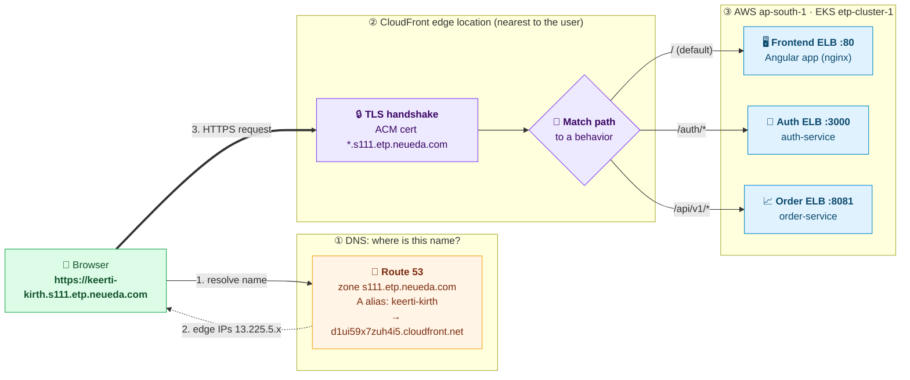
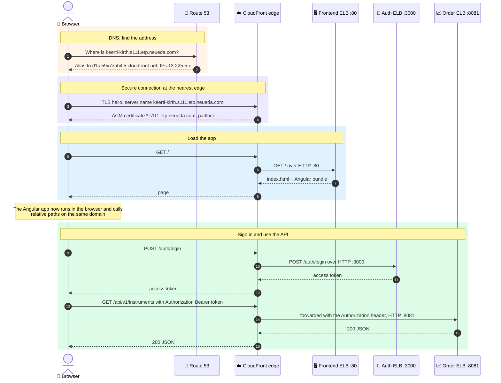

# CloudFront deployment

How the app is served through CloudFront, and the exact steps to apply or recreate the setup. Everything goes
through one HTTPS address; the browser never calls a load balancer directly.

```text
https://keerti-kirth.s111.etp.neueda.com      (custom domain, section 6)
  = https://d1ui59x7zuh4i5.cloudfront.net
  /            -> frontend ELB  :80    (Angular app, nginx)
  /auth/*      -> auth ELB      :3000  (auth-service)
  /api/v1/*    -> order ELB     :8081  (order-service / trade API)
```

| | Value |
|---|---|
| Distribution ID | `E2BI3F7J0AU587` |
| CloudFront domain | `d1ui59x7zuh4i5.cloudfront.net` |
| Custom domain | `keerti-kirth.s111.etp.neueda.com` |
| Route 53 hosted zone | `s111.etp.neueda.com` (`Z085124215ZFSEBQN4H6X`) |
| ACM certificate (us-east-1) | `*.s111.etp.neueda.com`, `arn:aws:acm:us-east-1:151995619939:certificate/d35c1ed7-4fec-44a3-8720-909348e20391` |
| AWS account / region | `151995619939` / `ap-south-1` (CloudFront itself is global) |
| EKS cluster | `etp-cluster-1` |
| Frontend ELB | `a58da1b86413548d3a06809556fddbfd-450641022.ap-south-1.elb.amazonaws.com` (port 80) |
| Auth ELB | `ab36a1e00eb414989887df8adf3842d5-1811272095.ap-south-1.elb.amazonaws.com` (port 3000) |
| Order ELB | `a08eb7f6261f841eda21ded821352b7c-233898707.ap-south-1.elb.amazonaws.com` (port 8081) |

The ELB hostnames change whenever a Service is deleted and recreated. Get the current ones with:

```bash
kubectl get svc frontend auth-service order-service \
  -o custom-columns=NAME:.metadata.name,HOST:.status.loadBalancer.ingress[0].hostname,PORT:.spec.ports[0].port
```

## 1. Kubernetes

### Public Services

The frontend, auth and order Services must be internet-facing so CloudFront can reach them. The base manifests
already carry the annotation:

```yaml
metadata:
  annotations:
    service.beta.kubernetes.io/aws-load-balancer-scheme: internet-facing
```

If a Service was created as internal, changing the annotation does not change its existing ELB. Recreate only
that Service:

```bash
kubectl delete service <name>
kubectl apply -k k8s/overlays/four-lb
kubectl get svc <name>          # wait for the new hostname
```

Recreating a Service gives it a **new ELB hostname**: update `urls.env` (below) and the CloudFront origin to match.
Do not delete Deployments, PVCs, Secrets or the cluster for this.

### urls.env

`k8s/overlays/four-lb/urls.env` becomes the ConfigMap `etp-urls`, read by the frontend, auth and order pods:

```env
FRONTEND_URL=https://d1ui59x7zuh4i5.cloudfront.net
AUTH_SERVICE_URL=http://<AUTH_ELB_DNS>
ORDER_SERVICE_URL=http://<ORDER_ELB_DNS>
EXECUTOR_SERVICE_URL=http://<EXECUTOR_ELB_DNS>
CORS_ALLOWED_ORIGINS=https://d1ui59x7zuh4i5.cloudfront.net
URL_REWRITES=<public-auth-url>:<port>= <public-order-url>:<port>= http://localhost:3000= http://localhost:8081= http://<AUTH_ELB_DNS>:3000= http://<ORDER_ELB_DNS>:8081=
```

- `FRONTEND_URL` is the origin the auth service puts in its CORS response (`Access-Control-Allow-Origin`), so it must
  be the CloudFront URL exactly: `https`, no trailing slash, no leading space.
- `URL_REWRITES` points the Angular bundle at CloudFront **without rebuilding the image**. Each `from=to` pair is
  replaced in the built files every time the frontend container starts. Every pair here has an empty `to`, so
  whatever API address the image was built with becomes `""` and the app calls relative paths
  (`/auth/login`, `/api/v1/...`) on the CloudFront domain. Keep it on one line, pairs separated by spaces, each
  ending in `=`. List every address a build might contain: unfilled placeholders, `localhost`, and the ELB
  addresses.

Do not point the frontend at the ELBs directly: the page is served over HTTPS and the browser blocks plain-HTTP
API calls from it (mixed content).

### Apply

Do **not** run `kubectl apply -k k8s/overlays/four-lb` on its own: it resets the Deployments to the base image
names. Update the ConfigMap the Deployments use instead:

```bash
cd chennai-capstone-SE5-team2
aws eks update-kubeconfig --region ap-south-1 --name etp-cluster-1

# the ConfigMap name the pods use (it carries a hash, e.g. etp-urls-982d78246h)
CM=$(kubectl get deploy frontend -o jsonpath='{.spec.template.spec.containers[0].envFrom[0].configMapRef.name}')

kubectl create configmap "$CM" --from-env-file=k8s/overlays/four-lb/urls.env \
  --dry-run=client -o yaml | kubectl apply -f -
kubectl rollout restart deployment/frontend deployment/auth-service deployment/order-service
kubectl rollout status deployment/frontend --timeout=180s
kubectl rollout status deployment/auth-service --timeout=180s
kubectl rollout status deployment/order-service --timeout=180s
```

Check the rewrite ran. Each address should map to an empty value, and the placeholder lines should report
`1 file(s)`:

```bash
kubectl logs deploy/frontend | grep 'frontend:'
# frontend: <public-auth-url>:<port> ->  (1 file(s))
# frontend: <public-order-url>:<port> ->  (1 file(s))
# ...
```

Never put passwords or API keys in frontend build arguments: everything in the bundle is public.

## 2. CloudFront

### Origins

**CloudFront > Distributions > `E2BI3F7J0AU587` > Origins**

| Origin | Domain | Protocol | HTTP port |
|---|---|---|---|
| Frontend | `<FRONTEND_ELB_DNS>` | HTTP only | 80 |
| Auth | `<AUTH_ELB_DNS>` | HTTP only | **3000** |
| Order | `<ORDER_ELB_DNS>` | HTTP only | **8081** |

- Enter only the hostname in the domain field: no `http://`, no port.
- Set the port in the **HTTP port** field. The default is 80; the auth and order ELBs do not listen on 80, so
  leaving it makes every `/auth` and `/api` request **time out**.

### Behaviors

**Default (`*`)**: frontend origin, Redirect HTTP to HTTPS.

**API behaviors**, all with the same settings:

| Path pattern | Origin |
|---|---|
| `/auth/*` | Auth |
| `/api/v1/*` | Order |

| Setting | Value |
|---|---|
| Viewer protocol policy | Redirect HTTP to HTTPS |
| Allowed HTTP methods | GET, HEAD, OPTIONS, PUT, POST, PATCH, DELETE |
| Cache policy | **CachingDisabled** |
| Origin request policy | **AllViewerExceptHostHeader** |

The origin request policy is required: without it CloudFront drops the `Authorization` header, so login succeeds
but every call after it returns 401. It also forwards `Content-Type`, `Origin`, query strings and cookies. Never
cache login, refresh or authenticated responses.

**Optional behaviors** (same settings). Without them these paths fall through to the frontend and get the HTML page:

| Path pattern | Origin | Used by |
|---|---|---|
| `/socket.io/*` | Auth | live session channel (sign-out when the user signs in elsewhere) |
| `/health` | Auth | API status page |
| `/actuator/*` | Order | API status page |

### Apply from the CLI

The same change as the console steps, for the origins and the two API behaviors. Back up first:

```bash
aws cloudfront get-distribution-config --id E2BI3F7J0AU587 > ~/cf-backup.json
python3 - <<'PY'
import json, os
d = json.load(open(os.path.expanduser('~/cf-backup.json'))); c = d['DistributionConfig']
ports = {'<AUTH_ELB_DNS>': 3000, '<ORDER_ELB_DNS>': 8081}   # origin Id -> port
for o in c['Origins']['Items']:
    if o['Id'] in ports:
        o['CustomOriginConfig']['HTTPPort'] = ports[o['Id']]
for b in c['CacheBehaviors']['Items']:
    b['OriginRequestPolicyId'] = 'b689b0a8-53d0-40ab-baf2-68738e2966ac'   # AllViewerExceptHostHeader
json.dump(c, open(os.path.expanduser('~/cf-new.json'), 'w'))
open(os.path.expanduser('~/cf-etag.txt'), 'w').write(d['ETag'])
PY
aws cloudfront update-distribution --id E2BI3F7J0AU587 --if-match "$(cat ~/cf-etag.txt)" \
  --distribution-config file://$HOME/cf-new.json --query 'Distribution.Status' --output text
```

To roll back, rebuild `cf-new.json` from the `DistributionConfig` in `~/cf-backup.json` and run the same update
with the distribution's current ETag.

### Wait for deployment

```bash
aws cloudfront get-distribution --id E2BI3F7J0AU587 \
  --query 'Distribution.{Status:Status,Domain:DomainName}' --output table
```

Continue only when `Status` is `Deployed` (3-5 minutes).

### Inspect

```bash
aws cloudfront get-distribution --id E2BI3F7J0AU587 \
  --query 'Distribution.{Status:Status,Origins:DistributionConfig.Origins.Items[].{Id:Id,Domain:DomainName,Port:CustomOriginConfig.HTTPPort,Protocol:CustomOriginConfig.OriginProtocolPolicy},Behaviors:DistributionConfig.CacheBehaviors.Items[].{Path:PathPattern,Target:TargetOriginId,OriginRequestPolicy:OriginRequestPolicyId}}' \
  --output json
```

## 3. Cache invalidation

After changing frontend assets or behaviors:

```bash
aws cloudfront create-invalidation --distribution-id E2BI3F7J0AU587 --paths '/*'
```

Wait for it to complete, then hard-refresh the browser (Ctrl+Shift+R).

## 4. Verification

Open these in the browser:

| URL | Expected |
|---|---|
| `https://d1ui59x7zuh4i5.cloudfront.net/` | The app's landing page |
| `https://d1ui59x7zuh4i5.cloudfront.net/auth/public-key` | JSON with a `publicKey` field |
| `https://d1ui59x7zuh4i5.cloudfront.net/api/v1/instruments` | A 401 JSON error (routing works; no token) |

Then sign in with DevTools open (**Network** tab):

- The login request goes to `https://d1ui59x7zuh4i5.cloudfront.net/auth/login`, not to an ELB or a
  `<public-auth-url>` placeholder.
- Its response headers include `access-control-allow-origin: https://d1ui59x7zuh4i5.cloudfront.net`.
- Pages after sign-in load data; `/api/v1/...` requests return 200, not 401.

## 5. Common failures

| Symptom | Cause | Fix |
|---|---|---|
| Request URL contains `<public-auth-url>:<port>`, **405** | Frontend image built with unfilled placeholders | Add the placeholder to `URL_REWRITES` (already listed) and restart the frontend |
| `/auth/*` or `/api/*` returns **405** | Behavior points at the frontend origin | Point it at the auth / order origin |
| `/auth/*` or `/api/*` **times out** | Origin HTTP port left at 80 | Set the auth origin to 3000 and the order origin to 8081 |
| **502**, origin resolution error | ELB is internal or the hostname is wrong | Use an internet-facing ELB; hostname only in the domain field |
| **502** with an HTTPS origin | Origin protocol is HTTPS; the ELBs serve plain HTTP | Origin protocol policy: HTTP only |
| Login works, then everything **401** | `Authorization` header not forwarded | Origin request policy AllViewerExceptHostHeader |
| CORS error naming the old ELB | `FRONTEND_URL` not updated or not applied | Set `FRONTEND_URL` and `CORS_ALLOWED_ORIGINS` to the CloudFront URL, apply, restart auth |
| Browser blocks the request as mixed content | Bundle still calls `http://...elb...` | Add that address to `URL_REWRITES` and restart the frontend |
| `get-distribution` says **NoSuchDistribution** | Wrong ID or wrong AWS account | `aws cloudfront list-distributions`; this project uses `E2BI3F7J0AU587` |
| `/api/v1/...` returns **401** | Routing works; no token sent | Expected without a valid access token |
| Custom domain does not resolve at all | Route 53 alias target typed as `https://d1ui...` or `http://d1ui...` | Target is the bare hostname `d1ui59x7zuh4i5.cloudfront.net` |
| Certificate error or **403** "request could not be satisfied" on the custom domain | Domain not in CloudFront's alternate domain names, or spelled differently there | Add it in step 6.4; the spelling must match Route 53 exactly |
| Works for others, not on your machine | Your machine cached the earlier "does not exist" answer | Flush DNS (`ipconfig /flushdns`, `chrome://net-internals/#dns`), use incognito or mobile data, or wait 5-15 min |

## 6. Custom domain: Route 53 + ACM

Goal: open the app at **`https://keerti-kirth.s111.etp.neueda.com`** instead of `d1ui59x7zuh4i5.cloudfront.net`.
Three pieces have to agree on the same name, spelled exactly the same:

| Piece | What it does |
|---|---|
| **ACM certificate** | Proves to the browser that CloudFront is allowed to serve this name (the padlock) |
| **Route 53 record** | Tells the browser where the name lives (CloudFront's edge IPs) |
| **CloudFront alternate domain** | Tells CloudFront to accept requests for this name |

### 6.1 ACM certificate (already done)

A wildcard certificate already exists and is **Issued**. It covers every `<name>.s111.etp.neueda.com`, so any
subdomain we pick needs no new certificate.

```bash
aws acm list-certificates --region us-east-1 \
  --query 'CertificateSummaryList[].{Domain:DomainName,Status:Status,Arn:CertificateArn}' --output table
```

- CloudFront only uses certificates from **us-east-1 (N. Virginia)**, whatever region the app runs in.
- To create a new one: **ACM (us-east-1) > Request > Public certificate**, enter the domain, choose **DNS
  validation**, then click **Create records in Route 53**. The `_4e39f...` CNAME in the hosted zone is that
  validation record; leave it in place so the certificate keeps renewing.

### 6.2 Route 53 record

**Route 53 > Hosted zones > `s111.etp.neueda.com` > Create record**

| Field | Value |
|---|---|
| Record name | `keerti-kirth` |
| Record type | **A** |
| Alias | **On** |
| Route traffic to | **Alias to CloudFront distribution** |
| Target | `d1ui59x7zuh4i5.cloudfront.net` |
| Evaluate target health | No |

- The target is a **hostname only**. Never type `https://` or `http://`: DNS has no idea what a protocol is, and a
  target of `https://d1ui...` is a name that does not exist, so the domain resolves to nothing. HTTPS is handled by
  CloudFront and the ACM certificate, not by DNS.
- The console dropdown only lists the distribution once it carries this alternate domain (step 6.4). Until then,
  paste the hostname into the field.
- Optional: repeat with record type **AAAA** (same alias) for IPv6.

CLI equivalent (`Z2FDTNDATAQYW2` is the fixed hosted zone ID of every CloudFront alias):

```bash
aws route53 change-resource-record-sets --hosted-zone-id Z085124215ZFSEBQN4H6X --change-batch '{
  "Changes":[{"Action":"UPSERT","ResourceRecordSet":{
    "Name":"keerti-kirth.s111.etp.neueda.com","Type":"A",
    "AliasTarget":{"HostedZoneId":"Z2FDTNDATAQYW2","DNSName":"d1ui59x7zuh4i5.cloudfront.net","EvaluateTargetHealth":false}}}]}'
```

Check that DNS now points at CloudFront:

```bash
dig +short keerti-kirth.s111.etp.neueda.com      # CloudFront edge IPs, e.g. 13.225.5.x
```

### 6.3 Point the app at the new name

In `k8s/overlays/four-lb/urls.env`:

```env
FRONTEND_URL=https://keerti-kirth.s111.etp.neueda.com
CORS_ALLOWED_ORIGINS=https://keerti-kirth.s111.etp.neueda.com
```

Apply the ConfigMap and restart the three Deployments exactly as in **1. Kubernetes > Apply**. `URL_REWRITES` needs
no change: the app already calls relative paths, which work on any domain.

At this point DNS sends the browser to CloudFront, but opening the domain still fails with a **certificate error**
(CloudFront answers with its default `*.cloudfront.net` certificate) or a **403 "The request could not be
satisfied"**. CloudFront does not know the name yet. One step left.

### 6.4 ✨ The final step: give CloudFront its new name

> Everything is in place: the certificate is issued, DNS points at the edge, the app expects the new origin.
> CloudFront is the only one still saying *"never heard of that name"*. Introduce them.

**CloudFront > Distributions > `E2BI3F7J0AU587` > General > Settings > Edit**

| Field | Value |
|---|---|
| Alternate domain name (CNAME) | **Add item** > `keerti-kirth.s111.etp.neueda.com` |
| Custom SSL certificate | `*.s111.etp.neueda.com` (the ACM certificate from 6.1) |
| Security policy | `TLSv1.2_2021` |

**Save changes**, and watch *Last modified* go from **Deploying** to a date (about 3-5 minutes).

CLI equivalent:

```bash
aws cloudfront get-distribution-config --id E2BI3F7J0AU587 > ~/cf-backup.json
python3 - <<'PY'
import json, os
d = json.load(open(os.path.expanduser('~/cf-backup.json'))); c = d['DistributionConfig']
c['Aliases'] = {'Quantity': 1, 'Items': ['keerti-kirth.s111.etp.neueda.com']}
c['ViewerCertificate'] = {
    'ACMCertificateArn': 'arn:aws:acm:us-east-1:151995619939:certificate/d35c1ed7-4fec-44a3-8720-909348e20391',
    'SSLSupportMethod': 'sni-only', 'MinimumProtocolVersion': 'TLSv1.2_2021'}
json.dump(c, open(os.path.expanduser('~/cf-new.json'), 'w'))
open(os.path.expanduser('~/cf-etag.txt'), 'w').write(d['ETag'])
PY
aws cloudfront update-distribution --id E2BI3F7J0AU587 --if-match "$(cat ~/cf-etag.txt)" \
  --distribution-config file://$HOME/cf-new.json --query 'Distribution.Status' --output text
```

Now open **https://keerti-kirth.s111.etp.neueda.com** 🎉

```bash
curl -sI https://keerti-kirth.s111.etp.neueda.com | head -1                       # HTTP/2 200
curl -sv https://keerti-kirth.s111.etp.neueda.com -o /dev/null 2>&1 | grep subject # CN=*.s111.etp.neueda.com
```

| URL | Expected |
|---|---|
| `https://keerti-kirth.s111.etp.neueda.com/` | Landing page, padlock shows `*.s111.etp.neueda.com` issued by Amazon |
| `https://keerti-kirth.s111.etp.neueda.com/auth/public-key` | JSON with a `publicKey` field |
| `https://keerti-kirth.s111.etp.neueda.com/api/v1/instruments` | A 401 JSON error (routing works; no token) |

Sign in: the login request goes to `https://keerti-kirth.s111.etp.neueda.com/auth/login`, and every call after it
returns data.

## 7. How a request flows

### The big picture



### Step by step: from typing the URL to seeing data



### What each piece does

| # | Piece | Job | Configured in |
|---|---|---|---|
| ① | **Route 53** | Answers *"where is keerti-kirth.s111.etp.neueda.com?"* with CloudFront's edge IPs. It only answers the lookup; it never sees the request itself | 6.2 |
| ② | **ACM** | Supplies the certificate the edge shows the browser, so the connection is HTTPS with a padlock | 6.1 |
| ② | **CloudFront edge** | Accepts the request for the custom name, ends HTTPS, and picks an origin by path | 2, 6.4 |
| ③ | **Frontend ELB** | Serves the Angular page and bundle | 1 |
| ③ | **Auth ELB** | Login, token refresh, public key | 1, 2 |
| ③ | **Order ELB** | Trade API (`/api/v1/*`) | 1, 2 |

Key point: **the frontend never calls the auth or order ELB itself.** The Angular app runs in the user's browser,
and every call it makes (`/auth/...`, `/api/v1/...`) goes back to the same domain. CloudFront then forwards it to
the right ELB. One domain and one certificate, no CORS issues and no mixed-content blocks, and the ELBs stay plain
HTTP behind the edge.

Never commit `.env`, `k8s/base/secrets.env`, passwords, API keys, JWT secrets or private certificates.
